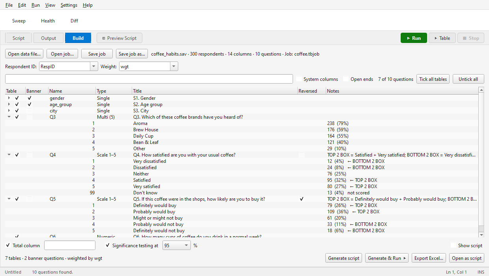
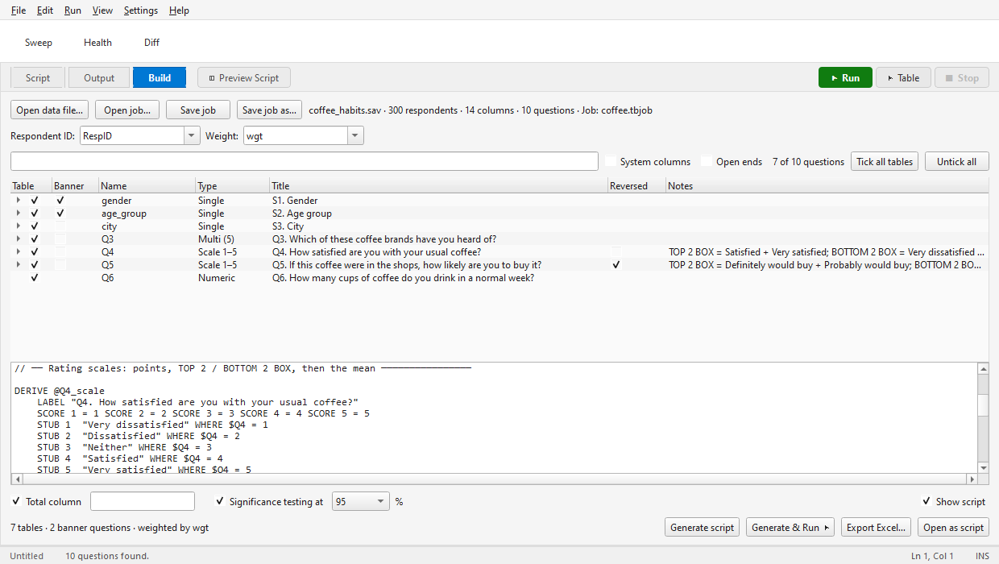

# Tutorial: build tables without writing script

You do not need to know MRScript to use this. Open your data, tick the questions you want, and
Tablix writes the script, checks it, runs it and exports the Excel.

It takes three steps:

1. **Open** the data file.
2. **See** every question with its title and answers.
3. **Tick** which questions become tables and which become banner columns.

!!! abstract "The data we use"

    A small coffee survey, `coffee_habits.sav`, with 300 respondents. It has gender, age group, city,
    a "which brands have you heard of" question, a satisfaction scale, a purchase-intent scale and a
    weight. The sample file is not included with Tablix: use any `.sav` file that has value labels
    and the steps are the same.

---

## Step 1 — Open the data file

Choose **Build ▸ Show Build screen**, then **Open data file…**. (Or use **File ▸ New Build Job from
Data File…**, which opens the Build screen for you.) On the Build screen the first button in the bar
at the top reads **Build**; the **Output** button next to it shows your tables.

Tablix reads the file and finds the questions. It also makes two guesses for you:

- **Respondent ID**: a column whose values are all different, such as `RespID` or `SbjNum`.
- **Weight**: a column called `weight`, `wgt` or `wt…`, or one the file marks as a weight.

Check both boxes. If a weight is selected, **every table is weighted**. The line under the list
tells you: `7 tables · 2 banner questions · weighted by wgt`. Choose `(none)` for unweighted tables.
See [Weighted counts](#weighted-counts-what-you-see-where) for what "weighted" shows on screen and in Excel.

---

## Step 2 — See every question



You see **one row per question**, not one row per column. This matters for multi-select
questions. A survey tool often stores one question as many 0/1 columns (`A_Q3_1`, `A_Q3_2`, …).
Tablix groups them back into one question, `Q3`, with its answers.

Each row shows:

| Column | What it tells you |
|--------|-------------------|
| **Table** | Tick to make a table from this question. |
| **Banner** | Tick to use its answers as columns across the top of every table. |
| **Name** | The question name. |
| **Type** | `Single`, `Multi (5)` (5 answers), `Scale 1–5`, `Numeric`. |
| **Title** | The question text. |
| **Reversed** | Only for scales. See [below](#reversed-scales). |
| **Notes** | For a scale, which answers are in TOP 2 BOX and BOTTOM 2 BOX. |

Click the arrow to open a question. You see its answers: the code, the label and **how many
respondents chose it**. Counts are unweighted.

Some columns are hidden because you would not tabulate them:

- **System columns**: interview data such as survey date and interviewer (tick *System columns* to see them).
- **Open ends**: free-text answers (tick *Open ends* to see them; they cannot be ticked).
- The respondent ID and the weight.

Use the search box to find a question by name, title or even an answer.

---

## Step 3 — Tick Table and Banner

Every question you can tabulate is already ticked as a **Table**. (Open ends, the ID, the weight and any
question with more than 100 answers are not.) Untick the ones you do not want. Use **Untick all**,
then tick only the few you need, if that is quicker.

A question whose column name has a character Tablix cannot use yet (a `.`, `#`, `$`, `@`, a space or an
accented letter, as in `Q1.a`) is greyed out and has no tick box. The **Notes** column says why. Rename
the column in the data file to use it: names can have only letters, digits and `_`.

Tick **Banner** on the questions whose answers should be the columns. Here we tick `gender`
and `age_group`. Every table then shows Total, Male, Female, 18-24, 25-34 and so on.

A few rules:

- A **numeric** question (cups per week) can be a table but not a banner.
- A **multi-select** question can be a banner. Its columns can overlap, and the significance test allows for that.
- Tables follow the order of the questions in the data file.

Two settings sit under the list:

- **Total column**: show it, and name it if you like (for example `All adults`).
- **Significance testing at 90 / 95 / 99 %**: untick it for tables with no letters.

---

## Fix what Tablix found

Tablix guesses the type of each question, and sometimes it guesses wrong. **Right-click a question** to change it.
A question you changed is **bold with a `*`**, and its **Notes** say what Tablix had found. **Undo my change** puts it back.

- **A scale that is not a scale.** A question such as "How many children?" can have answers 1 to 5 and look like a rating
  scale. Right-click it and choose **This is not a scale: make it a single question**. The table then has plain answers,
  with no TOP 2 BOX, no BOTTOM 2 BOX and no mean.
- **A single that is a scale.** Choose **This is a rating scale: choose its points…**. Pick the lowest and the highest
  point. An answer outside the points, such as `9 Not applicable`, stays in the table but is left out of the mean.
- **A multi-select with a column too many, or too few.** Choose **Edit the columns of this multi-select…**. Tick the
  columns that are answers of the question. A column you untick becomes a question of its own.
- **Columns that belong together.** Click **New multi-select…** (or right-click one column and choose **Put this column
  into a multi-select…**). Give the group a name and a title, and tick its columns. Only columns that hold 0, 1 or blank
  are listed.
- **A multi-select that is really separate questions** (for example "Seen on TV", "Seen on radio"): choose **Split into one
  question per column**. Each column gets its own Yes / No table.

If a change does not fit the data (a column that is not a 0/1 column, for example), Tablix says why and changes nothing.

Your changes are saved in the job. When the final data replaces the dummy data they are checked again. If the final data
has an **extra answer column in a group you changed**, that column shows up as its own question with a warning, so no answer
is lost without a word.

---

## Generate, run and export

| Button | What it does |
|--------|--------------|
| **Generate script** | Writes the script beside your job file and checks it. |
| **Generate & Run ▶** | The same, then runs it. The tables open in **Output**. |
| **Export Excel…** | Saves the tables as an Excel workbook. |
| **Open as script** | Makes a copy you can edit by hand. [See below](#take-over-by-hand). |

The first time, Tablix asks where to save your **job** (a small `.tbjob` file). The script and the
text output are saved next to it. Pressing **F5** in Build mode does the same as *Generate & Run*.

**To stop a run**, press **■ Stop** (or **Shift+F5**). Tablix finishes the step it is on, then stops, which
usually takes a moment. The status bar shows *Stopping…* and then *Stopped.* A stopped run shows no tables,
and your earlier output file stays as it was. The first run on a big new data file takes longer to stop,
because the file loads first.

The Excel workbook has three sheets: **Index**, **Count** and **Percentage**, with every table one
under another on the Count and Percentage sheets. (A numeric question, which has a mean and no
percentages, is on the Count sheet only.) Tablix checks the sheet list after the export.
The colours come from **Settings ▸ Excel Output Format…**.

### Weighted counts: what you see where

When a weight is selected, everything in the tables is weighted: the counts, the percentages and the means.
**Every format shows the same numbers as the Output tab** (Excel, CSV, HTML, PowerPoint and the AI-ready files).
Each table starts with three base rows:

| Row | What it is |
|-----|------------|
| **Base (wtd)** | the sum of the weights |
| **Base (unwtd)** | the number of people |
| **Effective base** | the base the significance tests use |

Without a weight there is one row, **Base**, the number of people. A count is a weighted count when a weight is on,
so a count and its percentage always agree.

The one place that still shows people is the answer list on the Build screen, before you run: its counts are
unweighted.

Other formats (CSV, HTML, PowerPoint, AI-ready) are in the **Export** menu. They save the tables on screen,
so use **Generate & Run** first.

**The Build menu and the rest of the window.** The **Build** menu has everything the buttons do (open a
job, save it, generate, run, export, open as script). While you are in Build:

- The tools that work on a script you typed are greyed out: **Tools** (Health Check, Compare Data Files,
  Reconcile, Provenance, AI Assist, Open-End Coding, Sweep), **Edit**, Run Table and Run All. They would
  act on the Script editor, not on your job.
- **Output** belongs to Build for as long as you came from Build. After a run, **F5**, **Ctrl+E** and
  **Esc** still work on your job, not on the Script editor.
- While a run is going, everything that starts work is greyed out. Only **Stop** works.
- **Ctrl+S** saves the job.

Tick **Show script** to see what Tablix wrote. You do not have to read it.



---

## Rating scales

Tablix spots a rating scale when the answers are a run of 3 to 11 codes with scale words
("Satisfied", "Agree", "Definitely would buy"…). It builds the table the usual market-research way:

1. The scale points, in code order, with their own labels.
2. **TOP 2 BOX** and **BOTTOM 2 BOX**, as two plain rows.
3. **Mean**, **Std Dev** and **Std Error**.

```text
Q4. How satisfied are you with your usual coffee?     (Total column, weighted)

Very dissatisfied [1]     14
Dissatisfied [2]          28
Neither [3]               84
Satisfied [4]            106
Very satisfied [5]        90
Don't know                15
TOP 2 BOX                196
BOTTOM 2 BOX              42
Mean                    3.71
```

Notes:

- The number in brackets is the **score** used for the mean.
- "Don't know" stays as a row. It has no score, so it is **not** in the mean.
- The TOP 2 and BOTTOM 2 rows have no score either, so they never enter the mean.
- A scale with fewer than 4 points gets a mean but no TOP 2 / BOTTOM 2 rows.

### Reversed scales

Some questions put the **best** answer first: `1 = Definitely would buy … 5 = Definitely would not buy`.
Tablix notices this and ticks **Reversed** for you (the box is shaded yellow if it thinks a scale is
reversed but you have not ticked it). When **Reversed** is ticked:

- TOP 2 BOX holds the **lowest** two codes (1 and 2).
- BOTTOM 2 BOX holds the highest two codes.
- The mean is reversed too, so **a higher mean is always better**.

You can see it in the list. The answers are marked `← TOP 2 BOX` and `← BOTTOM 2 BOX`, and the
table rows show their score:

```text
Q5. If this coffee were in the shops, how likely are you to buy it?

Definitely would buy [5]       85
Probably would buy [4]        122
Might or might not buy [3]     70
Probably would not buy [2]     39
Definitely would not buy [1]   20
TOP 2 BOX                     207
BOTTOM 2 BOX                   59
Mean                         3.63
```

!!! warning "Always look at the Notes column"

    Tablix guesses from the wording. A scale it does not recognise as reversed will still have
    TOP 2 BOX on the highest codes. Read the Notes column and the `←` marks for every scale.

    It also cannot tell a rating from other questions that look like one. A frequency question
    ("Always … Never") or a "just right" question ("Too light … Just right … Too dark") is built as a
    scale too, so its TOP 2 BOX is simply the two highest codes. Check what that means for the question.

---

## Your job is saved for you

A job that has been saved to a file is **saved again after every change** you make. Close Tablix,
come back, and use **File ▸ Open Build Job…** (or **Open job…**, or open the `.tbjob` file like any
script). Your ticks are all there.

The job records **question names**, not column positions. When the final data replaces the dummy
data, open the same job and press **Generate**. If a question is missing from the new file, Tablix
tells you exactly which ones, in the Problems panel, and writes nothing.

---

## Take over by hand

Need something the builder cannot do yet? Click **Open as script**. Tablix saves a copy of the
script (named `…_edit.mrs`) and opens it in the Script editor, where you can change anything.

This is **one way**. Your edits do not go back into the job, and the job does not change.

The script Tablix writes for a job is protected the other way round too. If you edit that script by
hand, Tablix will **ask before it replaces your edits**.

---

## From the command line

The same job file works from a terminal:

```powershell
mrscript generate --new coffee_habits.sav    # write a starter job: coffee_habits.tbjob
mrscript generate coffee_habits.tbjob        # write and check coffee_habits.mrs
mrscript run coffee_habits.mrs               # run it like any script
```

The starter job has no banner. To get columns, open `coffee_habits.tbjob` before the second command and
list question names in `"banner"`, for example `["gender", "age_group"]`.

See the [Script Builder reference](../reference/script-builder.md) for the job file and every option.

---

## What the builder does not do yet

The builder covers the common first pass. For these, use **Open as script** and the Script editor:

- NET rows, filters and "Base:" text on one table
- Banner columns defined by a condition (for example "core users = S9 code 1")
- Summary tables (one row per statement) and product tests with stacked exposures
- Weighting by RIM, grid tables, TURF

## Where to go next

<div class="grid cards" markdown>

-   :material-file-document-outline: **[Script Builder reference](../reference/script-builder.md)** —
    the job file, how questions are found, and exactly what is written for each type.

-   :material-script-text: **[Your first crosstab](first-crosstab.md)** —
    learn the script itself, one idea at a time, so you can take over by hand.

</div>
